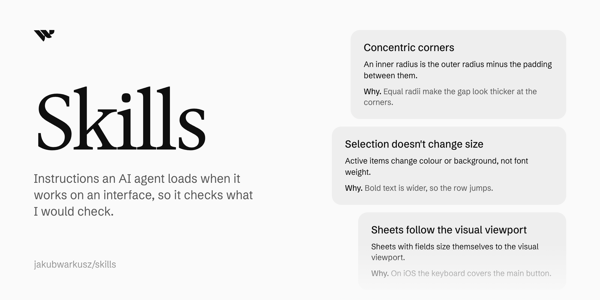

<picture>
  <source media="(prefers-color-scheme: dark)" srcset=".github/assets/banner-dark.png">
  
</picture>

<br>

Skills are instructions an AI agent loads when the task calls for them. These are the ones I use on interfaces: each one is a set of rules taken from fixes on real products, and each rule says why it exists, so the agent knows when to apply it and when to leave a deliberate choice alone.

## Install

```sh
npx skills add jakubwarkusz/skills
```

This lists every skill in the repository and installs the ones you pick, for Claude Code, Cursor, Codex and the other agents the [skills CLI](https://github.com/vercel-labs/skills) supports. To install one directly:

```sh
npx skills add jakubwarkusz/skills --skill interface-details
```

## Skills

| Skill | What it does |
| --- | --- |
| [interface-details](skills/interface-details/SKILL.md) | Reviews interface code and screens for the details people notice: depth and corners, every state of a control, motion in and out, copy and icons, and how it holds up on a phone. |

Each skill has its own page with every rule and an example at [wrksz.dev/skills](https://wrksz.dev/skills).

## Interface details

27 rules in six parts. The project's design system, brand and voice always come first; the rules fill the gaps and point out what is inconsistent.

| Part | Covers |
| --- | --- |
| Depth and shape | One recipe for depth, concentric corners, fields that don't look pressable, 40 px hit areas |
| States | Selection that doesn't change size, idle, working, done and failed, errors that say what to fix, undo over dialogs |
| Motion | CSS first, right from the first frame, quieter exits, one highlight under a list, themes that change at once |
| Text and icons | Drawn icons, decoration with a job, plain punctuation, concrete copy, streaming text left alone |
| Phones | `min-width: 0`, safe areas, sheets that follow the visual viewport, menus that don't rubber-band |
| Code | Ref callbacks over effects, no narrating comments, Tailwind rules only when the project uses it |

Ask for it by name or let the agent pick it up:

```text
Review the command menu in components/command-menu.tsx.
```

It answers with a short list of fixes, each with the file and line, what a person sees, and the change.

## How the skills are written

- **One rule, one reason.** Every rule ends with *Why*, so the agent can tell a mistake from a decision.
- **Numbers where they were measured**, principles where a number would only fit one design.
- **Short.** A skill is read into the agent's context every time it runs, so nothing is there for decoration.

## Layout

```text
skills/
  interface-details/
    SKILL.md
```

One folder per skill, named after it, with a `SKILL.md` that holds the name and description in its frontmatter. The CLI finds anything under `skills/`.

## License

[MIT](LICENSE)
